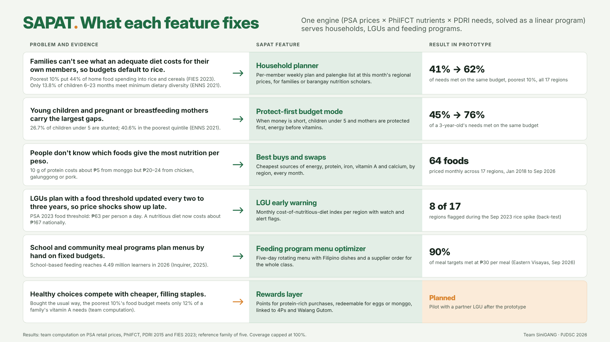

# SAPAT — *Sustansya na abot-kaya*

**The healthiest week a Filipino family's budget can buy, planned for each person, at this month's local market prices.**

Team SiniGANG · Philippine Junior Data Science Challenge 2026 · Public health analytics

> **Prototype notice.** SAPAT is a working prototype built to demonstrate the method on real Philippine data for PJDSC 2026. It has not yet been tested with families in the field, it is not a production service, and it gives meal-planning guidance only, not medical or clinical-nutrition advice. The family app opens with an example household so every screen can be shown. See [docs/LIMITATIONS.md](docs/LIMITATIONS.md).



## What it does

SAPAT links four public datasets and solves a linear program for each family:

| What | Source | Used for |
|---|---|---|
| What food costs | PSA OpenSTAT retail prices (11 tables) and SRA sugar prices, monthly, Jan 2018 – Sep 2026, by region, province and selected cities | Price of each of 61 foods |
| What food contains | DOST-FNRI Philippine Food Composition Tables (PhilFCT) | Nutrients per gram as purchased |
| What people need | DOST-FNRI Philippine Dietary Reference Intakes 2015 | Needs by age, sex, pregnancy and breastfeeding |
| What households spend | PSA Family Income and Expenditure Survey 2021 and 2023 | Food budgets and the "usual way" of spending them |

It ships as two apps on one shared engine:

- **Family app** (`web/family-app/`): plans the week's ulam and palengke list for each family member, follows the family through the week (Linggo → Palengke → Ngayon → Pamilya), and shows prices as ranges with the math behind every number. Features and how each addresses the problem: [docs/FEATURES.md](docs/FEATURES.md).
- **LGU dashboard** (`web/lgu-dashboard/`): province map of the cost of a healthy diet with Watch/Alert levels, and a feeding-program menu planner.

## Key results (Sep 2026 prices)

- **H1 holds in all 51 region-decile cases.** At the poorest 10%'s food budget, a SAPAT plan meets **62%** of a family's needs on average (mean adequacy over five nutrients, capped at 100%) against **41%** for the same pesos spent the usual way. For a 3-year-old: 76% against 45%.
- **A nutritious diet costs about ₱167 per person a day** nationally (₱178–281 across regions) for a reference family of five, against a PSA 2023 food threshold of ₱63.
- **Calcium drives more than half of that cost** (₱92 without it): milk, dilis, malunggay and tokwa are not in PSA's retail list.
- **Back-test:** the index flagged 8 of 17 regions in the Aug–Sep 2023 rice spike and 7 in the Dec 2022 onion crisis.
- **Demo family** (Leyte, ₱1,290 a week, 5 members): SAPAT plan 63% of needs vs 46% the usual way.

## Quick start

### 1. Open the apps (no installation)

Double-click `web/family-app/index.html` or `web/lgu-dashboard/index.html`. They run offline in Chrome, Edge or Firefox. Details: [web/README.md](web/README.md).

Or serve them: `npm start` → http://localhost:5500 (or `python -m http.server 5500 --directory web`).

### 2. Reproduce the analysis (Python 3.10+)

```bash
pip install -r requirements.txt
python scripts/run_pipeline.py      # about 2 minutes; every step from data_clean/ to the apps' data
```

This regenerates `outputs/` (cost index, H1 results, EDA summary), `docs/figures/`, and the web data bundles in `web/shared/data/`.

### 3. Run the tests (Node 18+)

```bash
npm test
```

- `tests/smoke_test.js`: data bundles load and are consistent; the demo family's result (63% vs 46%) is reproduced; the plan stays within budget.
- `tests/parity_test.js`: the browser engine (JavaScript) and the reference engine (Python, HiGHS) agree on 40 random planning cases.

### Verified on 24 Oct 2026

| Check | Result |
|---|---|
| `python scripts/run_pipeline.py` from a clean copy | Reproduced `outputs/cond_index.csv`, `outputs/h1_results.csv`, `outputs/eda_results.json`, `sapat_data.js` and all 101,707 province prices exactly (0 differences) |
| `npm test` | 9/9 smoke checks; parity 40/40 cases, worst objective difference 0.0011% |
| `notebooks/SAPAT_EDA.ipynb` | All 59 code cells run without errors from the repository layout (with the raw FIES files in `data_raw/`) |
| Apps | Both open from the file system with no console errors |

## Repository layout

```
sapat/                    Python package: the reference model
  needs.py                  PDRI 2015 needs per person
  foods.py                  the 61 foods, groups, portion caps, diet rules
  data.py                   loads data_clean/, price fallback rules, food table per region and month
  model.py                  linear program (HiGHS via SciPy)
  typical.py                FIES "usual way" spending
scripts/                  pipeline steps (each runnable on its own)
  run_pipeline.py           runs every step in order
  build_clean_data.py       data_raw/ -> data_clean/   (reference_tables.py, parse_fct_pdf.py are its helpers)
  eda.py                    data_clean/ -> outputs/eda_results.json
  compute_index.py          cost of a nutritious diet, every region and month -> outputs/cond_index.csv
  h1_typical_vs_sapat.py    H1 test -> outputs/h1_results.csv, docs/figures/
  export_app_data.py        -> web/shared/data/sapat_data.js
  export_local_prices.py    -> web/shared/data/local_prices.js
  export_extra_nutrients.py -> web/shared/data/extra_nutrients.js
data_raw/                 source files as downloaded (large FIES files excluded; see its README)
data_clean/               processed data, committed (see its README)
outputs/                  analysis results
web/                      the apps (static, no build step)
  shared/                   sapat-engine.js (model + solver), sapat-ui.js (words, icons, units), data/ (generated)
  family-app/               index.html, styles.css, js/ (18 small files: state, prices, planner, screens/, sheets/, features/)
  lgu-dashboard/            index.html, data/ (map shapes, province index)
tests/                    smoke_test.js, parity_test.js, make_cases.py, cases.json
notebooks/                SAPAT_EDA.ipynb (scratch exploration)
survey/                   SAPAT_Survey.gs (Google Apps Script that builds the user survey form)
docs/                     ARCHITECTURE, DATA, DATA_PIPELINE, MODEL, FEATURES, SCENARIOS, LIMITATIONS, figures/
```

## Documentation

| Read | For |
|---|---|
| [docs/ARCHITECTURE.md](docs/ARCHITECTURE.md) | The three layers, module responsibilities, design decisions, how to extend |
| [docs/MODEL.md](docs/MODEL.md) | The optimization model: variables, constraints, budget mode, priorities |
| [docs/DATA.md](docs/DATA.md) | Sources and terms, lineage (which script makes which file), data dictionary |
| [docs/DATA_PIPELINE.md](docs/DATA_PIPELINE.md) | Cleaning methodology, crosswalks, unit conversions, validation |
| [docs/FEATURES.md](docs/FEATURES.md) | Every feature and the part of the problem it addresses |
| [docs/SCENARIOS.md](docs/SCENARIOS.md) | Eating situations handled, partly handled, not yet; evidence behind the health guides |
| [docs/LIMITATIONS.md](docs/LIMITATIONS.md) | Prototype scope, data and model limitations |

## Dependencies

| Part | Needs |
|---|---|
| Apps | A modern browser. Fonts load from Google Fonts when online; the apps fall back to system fonts offline |
| Pipeline | Python 3.10+, `requirements.txt` (pandas, numpy, scipy, matplotlib) |
| Rebuild from raw files | Also `pdftotext` (poppler) and the raw files listed in `data_raw/README.md` |
| Notebook | `requirements-notebook.txt` (adds seaborn, scikit-learn, JupyterLab) |
| Tests | Node.js 18+ (no npm packages) |

## Team and license

Team SiniGANG, PJDSC 2026. Code under the [MIT License](LICENSE). Data remain under their publishers' terms ([docs/DATA.md](docs/DATA.md)).

## Sources

DOST-FNRI. (2018). *Philippine dietary reference intakes 2015: Summary tables* (rev. ed.).
DOST-FNRI. (2019). *Philippine food composition tables* [Data set]. https://i.fnri.dost.gov.ph/fct/library
DOST-FNRI. (2024). *Philippine nutrition facts and figures: 2021 Expanded National Nutrition Survey*.
Philippine Statistics Authority. (2024). *2023 full year official poverty statistics of the Philippines*.
Philippine Statistics Authority. (2026). *Retail prices of agricultural commodities by geolocation, commodity, year and period* [Data set]. OpenSTAT. https://openstat.psa.gov.ph
Philippine Statistics Authority. (n.d.). *2021 and 2023 Family Income and Expenditure Survey: Volume 2 household summary* [Public use files]. https://psada.psa.gov.ph
Stigler, G. J. (1945). The cost of subsistence. *Journal of Farm Economics, 27*(2), 303–314.
World Food Programme. (2023). *Philippines – Food prices* [Data set]. Humanitarian Data Exchange. https://data.humdata.org/dataset/wfp-food-prices-for-philippines
