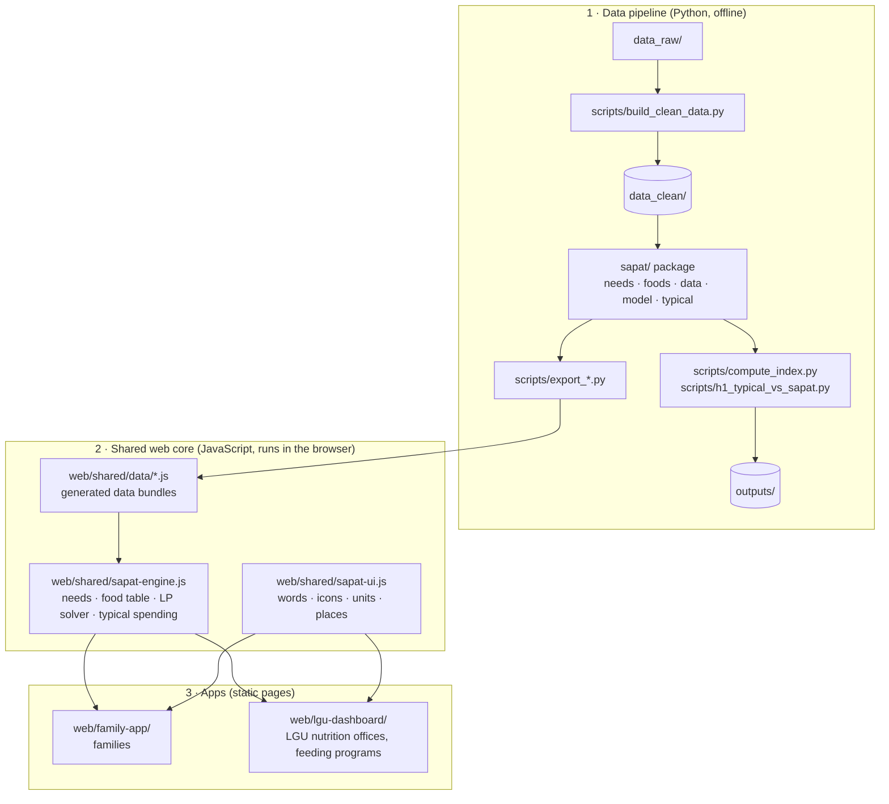

# Architecture

SAPAT has three layers. Each layer only depends on the one below it, so a new app, food or region can be added without touching the others.

## Layer 1: data pipeline (`sapat/`, `scripts/`)

| Module | Responsibility |
|---|---|
| `sapat/needs.py` | PDRI 2015 needs per person (age, sex, pregnancy, lactation) and the priority used in budget mode |
| `sapat/foods.py` | The 61-food list: PSA commodity → key, name, group, portion cap, unit; diet rules |
| `sapat/data.py` | Loads `data_clean/`, applies price fallback rules (carry forward ≤6 months), builds the food table for a region and month |
| `sapat/model.py` | The linear program (HiGHS via SciPy): least-cost full diet, or best diet within a budget |
| `sapat/typical.py` | Spends a FIES decile's food budget the "usual way" for the comparison |
| `scripts/*.py` | Thin command-line steps that call the package and write files; `run_pipeline.py` runs them in order |

The Python engine is the **reference implementation**. It is the one the analysis and the H1 test use.

## Layer 2: shared web core (`web/shared/`)

| File | Responsibility |
|---|---|
| `sapat-engine.js` | The same model as `sapat/model.py`, ported to JavaScript with a bounded simplex solver, so plans solve on the phone with no server. `tests/parity_test.js` checks it against the Python engine on 40 random cases (objective within 0.0011%). Also: food table with price layers (your price → market → city → province → region), typical spending, cheapest sources, feeding-program menu |
| `sapat-ui.js` | Things both apps show the same way: Tagalog/English words, icons, food pictures, family figures, nutrient targets, household portions, market selling units, place picker |
| `data/*.js` | Generated by `scripts/export_*.py` (see `docs/DATA.md`). Plain `<script>` globals, so the apps open straight from the file system without a build step or server |

## Layer 3: apps (`web/family-app/`, `web/lgu-dashboard/`)

| App | Files | Notes |
|---|---|---|
| Family app | `index.html` (shell and phone frame), `js/` (18 ordered scripts: state, prices, planner, tracking, shell, `screens/`, `sheets/`, `features/`; map in `js/README.md`), `styles.css` (design tokens and components) | State lives in the browser's `localStorage` (prefix `sapatm3:`); nothing is sent anywhere |
| LGU dashboard | `index.html` (one file: map, feeding program, how it works), `data/ph_*.js` (map shapes, province index) | Reads the same engine and data as the family app |

## Design decisions

- **No backend, no build step.** Static files that run offline in any modern browser. Hosting is free (GitHub Pages) and families pay no data for a server round trip. The trade-off: no shared database yet, so prices a family enters stay on their phone.
- **One model, two implementations, one test.** Python for analysis (fast to write, trusted solver), JavaScript for the phone (no install). The parity test keeps them equal.
- **Generated data is committed.** Judges and users can run the apps without Python; anyone can regenerate the bundles with one command.
- **Names, not magic numbers.** Food keys (`galunggong`, `rice_rm`) are the same in Python, JSON and JavaScript; region keys are the same across PSA, FIES and the apps (`data_clean/region_crosswalk.csv`).

## How to extend

| To add | Change | Then run |
|---|---|---|
| A food | Add it to `sapat/foods.py` and `data_clean/commodity_crosswalk.csv` (needs a PSA price series and a PhilFCT entry); add its Tagalog name and selling unit in `web/shared/sapat-ui.js` (`TL`, `buyUnits`) | `python scripts/run_pipeline.py --raw data_raw` |
| New monthly prices | Download the new OpenSTAT tables into `data_raw/psa_openstat_retail_prices/` | `python scripts/run_pipeline.py --raw data_raw`, then `npm test` |
| Market-level prices (e.g. DA price monitoring) | Fill `markets` in `local_prices.js` (format documented in `web/shared/sapat-engine.js`); the engine already uses them ahead of city and province prices | `npm test` |
| A new app (e.g. palengke vendors, carinderia) | New folder under `web/` that loads `../shared/` the same way `web/family-app/index.html` does | — |
| A screen or sheet | New file in `web/family-app/js/screens/` or `js/sheets/`, plus a `<script>` tag in `index.html` before `main.js` | — |
| A health guide or swap pair | `GUIDE` in `web/family-app/js/features/guide.js`, `SWAPS` in `js/features/swap.js` | — |
| Words or translations | `W` in `web/shared/sapat-ui.js` (shared) or `W2` in `web/family-app/js/words.js` (family app) | — |
