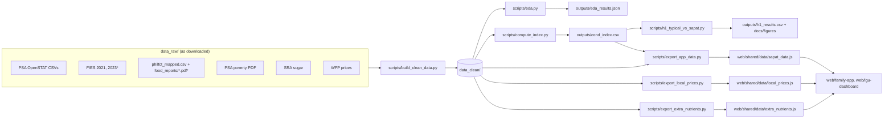

# Data: sources, files, lineage and dictionary

Every number in SAPAT traces back to a public source. This page lists each dataset, where it comes from, which script makes it, and what its main columns mean.

## 1. Sources

| Dataset | Publisher | Coverage used | Terms |
|---|---|---|---|
| Retail prices of agricultural commodities (11 OpenSTAT tables) | Philippine Statistics Authority (PSA) | Jan 2018 – Sep 2026; national, 17 regions + NIR, 82 provinces, 18 cities | PSA open data; cite PSA |
| Family Income and Expenditure Survey 2021 and 2023, Volume 2 household summary (public-use files) | PSA | 328,297 households | PSA microdata terms of use; raw files not redistributed here |
| 2023 Full Year Official Poverty Statistics (Tables 1 and 3) | PSA | Food and poverty thresholds, poverty incidence, 2018/2021/2023 | Public publication |
| Philippine Food Composition Tables (PhilFCT) | DOST-FNRI | 61 foods: energy, protein, fat, carbohydrate, fiber, iron, vitamin A (RAE), calcium, zinc, vitamin C, edible portion | Public; cite DOST-FNRI |
| Philippine Dietary Reference Intakes 2015 (rev. 2018) | DOST-FNRI | Needs by age, sex, pregnancy and lactation | Encoded as tables in `sapat/needs.py` and `web/shared/sapat-engine.js` |
| Retail sugar prices, Metro Manila | Sugar Regulatory Administration (SRA) | Sep 2018 – Sep 2026 | Public bulletins |
| Philippines – Food Prices | World Food Programme via HDX | 2018 – Nov 2023 | CC BY-IGO (HDX); used only to validate PSA prices |
| Region and province boundaries (map) | faeldon/philippines-json-maps (PSGC 2023) | 17 regions, 84 provinces | MIT (upstream repository) |
| Place list (regions → provinces → cities/municipalities) | isaacdarcilla/philippine-addresses (PSGC) | All LGUs | MIT (upstream repository) |

## 2. Lineage: which script makes which file

\* Not committed (size or redistribution); see `data_raw/README.md`. Their processed results are committed in `data_clean/`.

`python scripts/run_pipeline.py` runs every step from `data_clean/` onward in order. Re-running it on 24 Oct 2026 reproduced `outputs/cond_index.csv`, `outputs/h1_results.csv`, `outputs/eda_results.json`, `sapat_data.js` and all 101,707 province prices in `local_prices.js` exactly (zero differences).

**Vendored, not generated by this repository:**

| File | What it is | Origin |
|---|---|---|
| `web/shared/data/places.js` | Region → province → city/municipality tree; `psa` links a place to its PSA price series | PSGC list from isaacdarcilla/philippine-addresses, linked to PSA place names by the team |
| `web/lgu-dashboard/data/ph_regions.js`, `ph_provinces.js` | Low-resolution region and province shapes pre-projected to SVG, plus the province cost index (reference family of five) | Shapes from faeldon/philippines-json-maps; index computed with the same engine and province prices as the apps (matches the Python regional index within 0.004%) |

## 3. Dictionary of the main tables

### `data_clean/nutrient_price_panel.csv.gz` (one row per region × food × month)

| Column | Meaning |
|---|---|
| `region_key` | `PH` (national), `NCR`, `CAR`, `R01`–`R13`, `R4A`, `R4B`, `BARMM`, `NIR` |
| `psa_commodity` | PSA commodity name, e.g. `GALUNGGONG, 1 KG` |
| `date` | First day of the month |
| `price` | PSA retail price in PHP per kg or per piece (see `grams_per_unit`) |
| `outlier_flag` | 1 if more than 4 robust SDs from its own 13-month rolling median (kept, flagged) |
| `fct_food_id`, `fct_food_name` | Matched PhilFCT entry |
| `match_type`, `note` | `matched` or `proxy`, with the reason for a proxy |
| `ep_pct` | Edible portion, % of weight as purchased |
| `energy_kcal` … `vit_c_mg` | Nutrients per 100 g **edible portion** (PhilFCT) |
| `price_per_100g_ap` | PHP per 100 g **as purchased** |
| `*_per_peso` | Nutrient obtained per peso spent |
| `php_per_10g_protein`, `php_per_1000kcal`, `php_per_mg_iron`, `php_per_100ug_vitA`, `php_per_100mg_calcium` | Peso cost of a fixed amount of each nutrient |

### `data_clean/fies_households_2021_2023.csv.gz` (one row per household)

| Column | Meaning |
|---|---|
| `year`, `region_key`, `urban` | Survey year, region, urban flag |
| `fsize`, `rfact`, `person_weight` | Household size, household weight, person weight (`rfact × fsize`) |
| `toinc`, `totex`, `pcinc` | Total income, total expenditure, per-capita income (PHP per year) |
| `food`, `food_home`, `food_outside` | Food spending: total, at home, away from home |
| `bread`, `meat`, `fish`, `milk`, `oil`, `fruit`, `veg`, `sugar`, `food_nec` | Food-at-home spending by FIES group (`bread` = cereals) |
| `food_share_income`, `food_share_exp` | Food spending ÷ income, ÷ expenditure |
| `food_pc_day`, `food_home_pc_day` | Food spending per person per day |
| `pop_decile` | Population-weighted per-capita income decile within year (1 = poorest) |

### `outputs/cond_index.csv` (one row per region × month)

| Column | Meaning |
|---|---|
| `cond_pp_day` | Cost of a nutritious diet, PHP per person per day, reference family of five (M35, F32, F10, M7, F3) |
| `cond_no_calcium_pp_day` | Same without the calcium target |
| `n_foods`, `min_coverage` | Foods priced that month; lowest share of any need met |
| `protein_share_cost` | Share of the cost going to protein foods |
| `vs_prev3`, `yoy` | Change vs the previous 3-month mean; vs the same month last year |
| `level` | `normal`, `watch` (≥5% above 3-month mean) or `alert` (≥10% above, or ≥15% year on year) |

### `outputs/h1_results.csv` (one row per region × decile × scenario)

| Column | Meaning |
|---|---|
| `budget_pp_day` | The decile's food-at-home budget per person per day at current prices |
| `scenario` | `sapat` (optimized) or `typical` (FIES spending pattern) |
| `mar`, `mar_child3`, `mar_mother` | Mean adequacy ratio (share of needs met, capped at 100%, mean of 5 nutrients): family, 3-year-old, mother |
| `energy_kcal` … `calcium_mg` | Share of each need met |

### Web data bundles (`web/shared/data/`)

| File | Global | Contents |
|---|---|---|
| `sapat_data.js` | `SAPAT_DATA` | Foods with nutrients per gram as purchased; PHP/kg by region × month (`prices`, flat array month-major) with a source code per cell (`1` observed, `2` carried forward ≤6 months, `3` estimated); FIES decile budgets and spending shares; regional cost index; regional statistics |
| `local_prices.js` | `SAPAT_LOCAL` | PHP/kg by province or city × month (Jan 2024 – Sep 2026) |
| `extra_nutrients.js` | `SAPAT_EXTRA` | Fat, carbohydrate, fiber and vitamin C per gram as purchased |
| `places.js` | `SAPAT_PLACES` | Place tree for the "Where you shop" picker |
