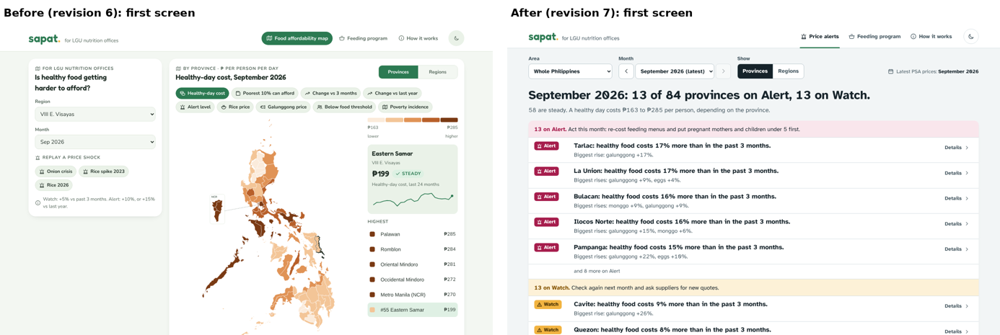

# Revision 7: LGU dashboard redesign

Target reader: a municipal nutrition action officer, a provincial health officer or a dietitian. They see the dashboard for the first time, have no training, and should understand it in under a minute.

Status: ✅ done in code · ⏸ needs people (the reason and the script are below).

| # | Item | Status | What changed |
|---|---|---|---|
| 1 | Talk to the reader first | ⏸ | This needs a real nutrition officer, BNS coordinator or dietitian, so it can't be done in code. The 15-minute script and the record sheet are below. Run it on the **new** version and the old one (in git history, `update 6`), so we can see whether the redesign answers what confused them. |
| 2 | Lead with the answer | ✅ | The page opens with one headline, for example *"September 2026: 13 of 84 provinces on Alert, 13 on Watch."* Under it is one sentence per area that needs attention, for example *"Tarlac: healthy food costs 17% more than in the past 3 months."* Each sentence carries the reason (*"Biggest rise: galunggong +17%"*). Each level group says what to do once (*"13 on Alert. Act this month: re-cost feeding menus and put pregnant mothers and children under 5 first."*). Five Alert and three Watch rows show at first; **Show all** lists every one. |
| 3 | Fewer metrics up front | ✅ | Three measures show as buttons: **Cost of a healthy day**, **Change vs past 3 months** and **Alert level**. The other six sit behind **More measures (6)**: change vs last year, what the poorest 10% can afford, rice price, galunggong price, people below the food line and families in poverty. |
| 4 | Plain names with units | ✅ | Measures have plain names, for example "Cost of a healthy day" with the unit "₱ per person per day". Every map title, table header and detail number shows its unit and month. The map, the table and each detail number name their source. |
| 5 | Explain the alert rule, with the back-test | ✅ | The section **How the levels are set, and what to do** gives the rule in words and the back-test (see below). It also has buttons that replay past shocks: Feb 2021 pork (ASF), Dec 2022 onions and Sep 2023 rice. Each area's detail also says which part of the rule fired, for example "17% above the past 3 months; Alert starts at 10%". |
| 6 | Table next to the map | ✅ | On screens 1100 px and wider, the map and the table sit side by side; on narrower screens a **Map / Table** switch shows one at a time. Click a column name to sort. The first click sorts one way, the second the other way, and the third goes back to alert order. Clicking a row or a province on the map opens that area below. **Print table** prints a clean table with the headline, the rule, the sources and the disclaimer. |
| 7 | Export | ✅ | **CSV** and **Excel** buttons download every area in view with all measures, the four key food prices, the sentence and the action. The Excel file has a frozen bold header and a second "Notes" sheet with the rule, the back-test, the sources and the disclaimer. It is written in the page itself, with no library, so it works offline. **One-page summary (PDF)** on each area opens the print window with an A4 page; choose *Save as PDF*. It has the status, the three numbers, a 3-year chart, key food prices, what to do, the rule, the sources and the disclaimer. Tested: it prints on one page. |
| 8 | Colour that works for everyone | ✅ | New status colours get lighter from Alert to Steady, so they read in grayscale and with every kind of colour blindness (checked below). Status never relies on colour alone: every status shows its word and an icon. On the map, Alert areas also get a ▲ and Watch areas a ●, on every measure. Amounts use a single blue ramp; change uses blue (cheaper) to orange (pricier). |
| 9 | "What can I do?" per level | ✅ | **Alert:** re-cost feeding menus (swap to cheaper protein rather than cut portions); coordinate with the DA provincial office and price monitoring; put pregnant or breastfeeding mothers and under-5s first (BNS master list, 4Ps, Walang Gutom); report to the Local Nutrition Committee and the LNAP. **Watch:** check next month; get new supplier quotes; ask BNS to watch for families cutting back. **Steady:** keep the monthly check; use the cost as the budget reference. These show for the chosen area and in the rule section for all three levels. |
| 10 | Keep the disclaimer | ✅ | *"SAPAT is planning guidance for programs, not medical advice…"* appears at the end of the alerts page, in the footer, on How it works, on the printed table, in the one-page summary and on the Excel Notes sheet. The test fails if it disappears. |

## Done-when check (until the interview happens)

Opening the page cold at 1366 × 860, without scrolling, a reader sees:

- **Which areas need attention:** the headline count, then Tarlac, La Union, Bulacan, Ilocos Norte and Pampanga on Alert, each led by a crimson **▲ Alert** tag.
- **Why:** "healthy food costs 17% more than in the past 3 months", with the food behind it.
- **What to do:** one line per level.

The interview below is the real test.

## Back-test (how the "1 false alert every 9 years" is counted)

- Data: all 84 provinces, April 2018 to July 2026. The first 3 months have no 3-month average, and the last 2 months can't be judged yet.
- An **Alert** starts in a month where a province is on Alert and was not the month before.
- It counts as **confirmed** if the cost of a healthy day stays at least 5% above the average of the 3 months before the alert for both of the next two months. Otherwise it is a **false alarm**.
- Result: 202 Alerts, 120 confirmed and 82 false alarms. Over 8.5 years per province, that is 0.98 false alarms per province, or **about 1 per province every 9 years** (8.7).
- The page computes this from the data when it loads, so it updates when the data does (`BACKTEST` in `js/areas.js`).
- Also checked: the rule on the page reproduces the pipeline's levels in 7,811 of 7,812 province-months.

## Colour-blindness check

The smallest colour difference (CIE ΔE) between any two status colours, simulated with the Machado (2009) model at full strength. Below about 10, the colours are hard to tell apart; 20 and above is comfortable.

| Palette | Normal | Protan | Deutan | Tritan |
|---|---|---|---|---|
| Old status (green / amber / red, all at the same lightness) | 35 | 20 | **9** | 35 |
| New status, light (#D3E3EA / #F2B441 / #A61E4D) | 72 | 60 | 52 | 48 |
| New status, dark mode (#33454E / #F2C14E / #FF6B9A) | 77 | 29 | 45 | 41 |

For a reader with deuteranopia, the most common colour blindness, the old Steady, Watch and Alert looked almost the same. The two map ramps keep at least ΔE 15 between neighbouring steps in all four views. On top of the colours, every status has its word and an icon, and the map has ▲ / ● marks.

## Talk to the reader: 15-minute script

Who: one or more of a municipal nutrition action officer (MNAO), a BNS coordinator, a provincial nutrition or health officer, or a registered nutritionist-dietitian. Use a laptop, opened at the dashboard with the latest month. Don't explain anything first.

1. **One minute, hands off the keyboard.** "This is a tool for LGU nutrition offices. Look at it for a minute and tell me what it's telling you." Start a timer. Note when they name an area that needs attention, and whether they can say why.
2. "If this were your province, what would you do this week because of it?" Note the decision, or "nothing".
3. "Find your own province and tell me how it's doing." Note how they look for it (area menu, map, table or the list) and how long it takes.
4. "What does *Watch* mean? What does *Alert* mean?" Can they answer without scrolling to the rule?
5. "You need this for the Local Nutrition Committee meeting. How would you get it into your report?" Do they find CSV, Excel, Print table or the one-page summary?
6. "What confused you, or what's missing?" Ask them to point at it.
7. "Is there a number here you don't trust, or would want to check?"
8. Show the old version (`update 6`) for 30 seconds: "Which would you rather use, and why?"

### Record sheet (one per person)

| Question | Answer |
|---|---|
| Role, LGU | |
| Seconds until they named an area that needs attention | |
| Could say why (yes / partly / no) | |
| Decision they'd make | |
| Found own province: how, and how long it took | |
| Explained Watch / Alert correctly (yes / partly / no) | |
| Found the export they needed | |
| Confusing or missing | |
| Numbers they'd want to check | |
| Old or new, and why | |

Done when at least one officer or dietitian names the areas that need attention, and why, within the first minute. Anything they find confusing becomes the next revision.

## Files

The dashboard is now split like the family app; the scripts load in order and run straight from the file:

| File | Job |
|---|---|
| `lgu-dashboard/index.html` | Markup and script order |
| `lgu-dashboard/dashboard.css` | Look: tokens (light and dark), status tags, map, table, detail, print pages |
| `js/core.js` | Data handles, formatting, icons, region names, tabs, theme |
| `js/areas.js` | Provinces and regions as one list, the 9 measures, the alert rule, sentences, the key food that rose, what to do, back-test |
| `js/situation.js` | Price alerts page: answer, measures, map, table, chosen area, rule section |
| `js/export.js` | CSV, Excel (.xlsx writer), print table, one-page summary |
| `js/menu.js`, `js/about.js`, `js/boot.js` | Feeding program (unchanged model), How it works, start-up |

Removed: the hidden family planner that was still inside the dashboard file. Its tab had been hidden since the family app took that job, and nothing linked to it.

Type: Atkinson Hyperlegible Next (Braille Institute, designed for low-vision reading), with Fredoka only for the wordmark.

## Tests

`t8` has 32 checks:

- The headline, and one sentence per area.
- 3 measures up front plus 6 behind More measures.
- Units, month and source on every number.
- The rule and back-test text.
- Sorting.
- Clicking a row or a map province.
- The region filter zooms the map.
- The 18-region view.
- An icon and a word on every status tag.
- ▲ / ● marks on the map.
- The "What you can do" panel.
- Past-shock replay.
- The CSV (84 rows, ₱ header) and the Excel download (opened with openpyxl: 2 sheets, frozen header).
- The print table and the one-page summary (1 page for Leyte and for Tarlac).
- The disclaimer.
- The Feeding program and How it works tabs.
- No errors.

There is no horizontal scroll at 360, 390, 768, 1024 or 1366 px. The family app is untouched (t7 still passes).
